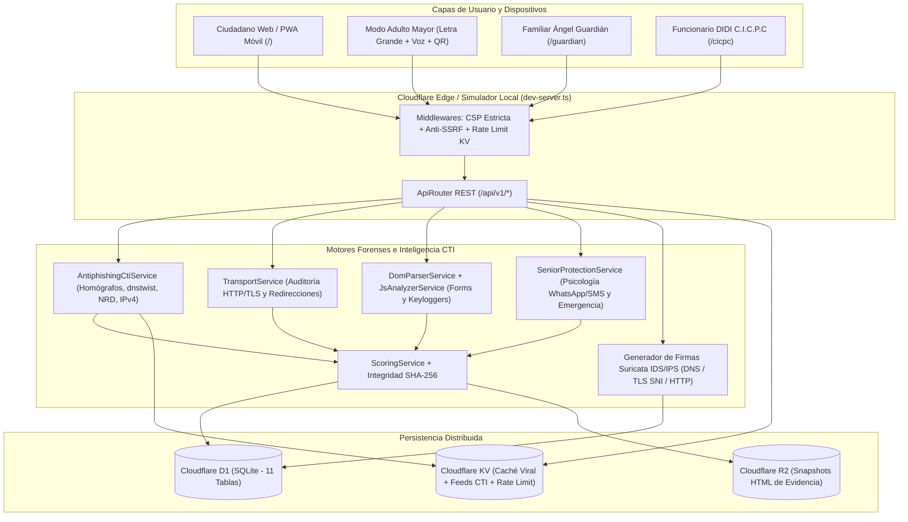

# Detector360 (AntiPhishing360)

**Plataforma Web Comercial, PWA Ciudadana Anti-Phishing, Suite Especializada "Modo Adulto Mayor & Ángel Guardián" y Módulo de Comando Forense C.I.C.P.C sobre Cloudflare Edge**


-0A3D91?style=for-the-badge)


**Detector360** es una solución integral de defensa digital ciudadana e inteligencia estratégica contra delitos informáticos. Permite a cualquier persona —incluyendo adultos mayores con asistencia visual, auditiva y apoyo familiar— inspeccionar enlaces sospechosos, mensajes completos de WhatsApp/SMS, capturas de pantalla y códigos QR en **menos de 2.5 segundos** sin abrir la página peligrosa en su dispositivo, articulando además la recepción de denuncias y generación de reglas perimetrales **Suricata IDS/IPS** para la **División de Investigaciones de Delitos Informáticos (C.I.C.P.C)**.

---

## Tabla de Contenidos

1. [Arquitectura General del Sistema](#1-arquitectura-general-del-sistema)
2. [Módulos Principales y Funcionalidades](#2-módulos-principales-y-funcionalidades)
   - [2.1 Motor Forense "Rayos X Web" + Heurística Predictiva Day-Zero](#21-motor-forense-rayos-x-web--heurística-predictiva-day-zero)
   - [2.2 Suite Integral para Personas Mayores ("Modo Adulto Mayor" y "Ángel Guardián")](#22-suite-integral-para-personas-mayores-modo-adulto-mayor-y-ángel-guardián)
   - [2.3 Módulo Restringido de Comando Estratégico C.I.C.P.C (`/cicpc`)](#23-módulo-restringido-de-comando-estratégico-cicpc-cicpc)
   - [2.4 Experiencia Comercial, Video Streaming HTTP 206 y PWA Móvil](#24-experiencia-comercial-video-streaming-http-206-y-pwa-móvil)
3. [Seguridad Defensiva y Criptografía](#3-seguridad-defensiva-y-criptografía)
4. [Estructura del Proyecto](#4-estructura-del-proyecto)
5. [Modelo de Datos en Cloudflare D1 (Migraciones SQL)](#5-modelo-de-datos-en-cloudflare-d1-migraciones-sql)
6. [Referencia Completa de Endpoints REST (`/api/v1`)](#6-referencia-completa-de-endpoints-rest-apiv1)
7. [Instalación y Ejecución Local Instantánea](#7-instalación-y-ejecución-local-instantánea)
8. [Credenciales de Prueba (Entorno Local de Demostración)](#8-credenciales-de-prueba-entorno-local-de-demostración)
9. [Suite Automatizada de Verificación (`16/16`) y CI/CD](#9-suite-automatizada-de-verificación-1616-y-cicd)
10. [Despliegue en Producción (Cloudflare Edge)](#10-despliegue-en-producción-cloudflare-edge)
11. [Créditos y Referencias Técnicas](#11-créditos-y-referencias-técnicas)

---

## 1. Arquitectura General del Sistema

Detector360 opera nativamente sobre estándares Web (`Fetch API`, `Web Crypto API`, `D1 SQLite`, `KV`, `R2`) sin dependencias pesadas de terceros en tiempo de ejecución, permitiendo desplegar el mismo código tanto en la red global de **Cloudflare Edge** como en un entorno local autónomo sobre **Node.js (`node:sqlite`)**.



---

## 2. Módulos Principales y Funcionalidades

### 2.1 Motor Forense "Rayos X Web" + Heurística Predictiva Day-Zero

Inspirado e integrado con las técnicas de ciberinteligencia proactiva de [`julioliraup/Antiphishing`](https://github.com/julioliraup/Antiphishing), el escáner combina **auditoría en vivo del código fuente** con **detección predictiva Day-Zero de URLs**:

- **Sustitución Homoglífica e IDN Punycode (`CTI_LEET_HOMOGLYPH_BRAND_SPOOF` / `CTI_IDN_HOMOGLYPH_ATTACK`)**: Identifica reemplazos visuales (`paypa1`, `banesc0`, `rn` por `m`, `vv` por `w`), codificaciones `xn--` y mezcla de caracteres cirílicos o griegos.
- **Permutaciones Typosquatting tipo `dnstwist` (`CTI_DNSTWIST_TYPOSQUATTING`)**: Cálculo puro de distancia **Damerau-Levenshtein** (omisión, inserción, sustitución y transposición adyacente) frente a más de 55 marcas globales, entidades bancarias nacionales e instituciones públicas, con **lista blanca estricta** para garantizar cero falsos positivos en portales legítimos.
- **Combosquatting Multilingüe y Estructura NRD (`CTI_BRAND_COMBOSQUATTING_IMPERSONATION` / `CTI_NRD_SOCIAL_ENGINEERING_STRUCTURE`)**: Detección de marcas combinadas con señuelos de ingeniería social (`ES`, `PT`, `EN`, `FR`, `DE`), guiones múltiples y cálculo de **entropía de Shannon** para dominios efímeros autogenerados.
- **Bloqueo de Hosts IPv4 Directos, Engaño `@` y Feeds CTI (`CTI_DIRECT_IPV4_PHISHING_HOST`, `CTI_URL_USERINFO_MASQUERADE`, `CTI_ANTIPHISHING_DATASET_MATCH`)**: Detección inmediata de servidores sin dominio (`http://45.142.x.x/login`), suplantación de autoridad con `@` y contraste contra feeds de dominios NRD/IPs cacheados en `KV_CACHE`.
- **Defensa Predictiva ante *Cloaking* o Servidores Caídos**: Si un dominio fraudulento recién registrado bloquea bots o aún no responde por HTTP, Detector360 protege igualmente al ciudadano emitiendo el diagnóstico preventivo a partir del análisis heurístico de la URL.
- **Inspección DOM + JavaScript + Huella `SHA-256`**: Detección de formularios sin cifrado (`http://`), exfiltración cruzada (`<form action>` hacia dominios terceros), captura silenciosa de pulsaciones (`keyup`/`keydown` keyloggers) y sellado criptográfico `SHA-256` del reporte.

---

### 2.2 Suite Integral para Personas Mayores ("Modo Adulto Mayor" y "Ángel Guardián")

Diseñada específicamente para proteger a padres y abuelos frente a manipulación emocional, fatiga visual y barreras tecnológicas:

1. **Accesibilidad Cognitiva y Visual ("Modo Adulto Mayor")**:
   - **Modo Letra Grande y Alto Contraste**: Botón superior persistente que amplía la escala tipográfica, simplifica la pantalla, oculta tecnicismos, activa el botón amarillo gigante **PEGAR Y REVISAR AHORA** y despliega un **Semáforo Gigante** (Verde / Amarillo / Rojo).
   - **Lectura por Voz Automática del Veredicto (Asistente Hablado)**: Narración pausada y clara en español mediante `Web Speech API` (`speechSynthesis`, velocidad `0.88`) que explica en voz alta qué hacer ante cada enlace o mensaje.
2. **Red de Apoyo Familiar ("Ángel Guardián")**:
   - **Botón "Preguntar a mi Hijo / Familiar de Confianza" en 1 Toque**: Genera una consulta vinculada en D1 con enlace único (`/guardian?token=...`) listo para compartir por WhatsApp. El familiar revisa el caso desde su propio teléfono y responde con un botón (**"Bórralo ya, es peligroso"** o **"Es seguro"**), actualizando y leyendo en voz alta la respuesta en la pantalla del adulto mayor.
   - **Alerta Automática ante Peligro Crítico**: Dentro del esquema Escudo Familiar, al detectarse un enlace o mensaje `CRITICAL`, se prepara automáticamente la alerta urgente para el familiar designado.
3. **Nuevos Vectores de Estafa Frecuentes en Personas Mayores**:
   - **Analizador de Mensajes Completos y Capturas de Pantalla (WhatsApp / SMS / OCR)**: Permite pegar el texto entero recibido (incluso directo en el buscador principal) o cargar una captura de pantalla (`BarcodeDetector`, `TextDetector` y metadatos) para descubrir engaños psicológicos sin enlace o con enlace:
     - *"Hola mamá, bendición, cambié de número..."* (`SENIOR_FAMILY_IMPERSONATION`)
     - *"Tu pensión / bono vence en 10 minutos..."* (`SENIOR_PENSION_BONUS_LURE`)
     - *"Pásame el código de 6 dígitos que llegó por SMS..."* (`SENIOR_OTP_HIJACK_ATTEMPT`)
     - *"Cuenta bloqueada / paquete retenido..."* (`SENIOR_BANK_PANIC_COERCION` / `SENIOR_PARCEL_TRAP`)
   - **Escáner Seguro de Códigos QR (Anti-Quishing)**: Usa la cámara desde la PWA (`Permissions-Policy: camera=(self)`) o sube una foto del código QR para inspeccionar su destino oculto con Rayos X **antes de abrir la página**.
   - **Directorio Blanco Oficial Verificado**: Buscador limpio con las direcciones web únicas y líneas telefónicas legítimas (`tel:`) de 15 bancos, organismos públicos (`IVSS`, `Patria`, `SAIME`, `SENIAT`, `Corpoelec`, `C.I.C.P.C`) y empresas de encomiendas (`Zoom`, `MRW`, `Tealca`).
4. **Contención Emocional y Respuesta de Emergencia**:
   - **Pausa Anti-Pánico de 15 Segundos**: Cuando se detecta presión extrema de tiempo o suplantación bancaria/familiar, despliega un temporizador calmado de `15s` con lectura por voz y las **3 Reglas de Oro** para romper la urgencia psicológica del estafador.
   - **Botón Rojo "¿Ya diste tu clave o hiciste un pago?"**: Guía en 3 pasos con botón de llamada inmediata (`tel:`) a la línea 24/7 de bloqueo de tarjetas del banco seleccionado y **envío automático de expediente prioritario `URGENT`** al módulo del C.I.C.P.C.
   - **Simulador de Entrenamiento Ligero (3 Preguntas con Casos Reales)**: Práctica interactiva semanal sin temor a equivocarse con ejemplos reales de mensajes de WhatsApp y SMS.

---

### 2.3 Módulo Restringido de Comando Estratégico C.I.C.P.C (`/cicpc`)

Canal institucional independiente (`/cicpc/login` y `/cicpc`), aislado criptográficamente de las sesiones ciudadanas y excluido de motores de búsqueda (`noindex, nofollow`):

- **Autenticación Institucional de 3 Factores Criptográficos**:
  1. Credencial Oficial (`badge_id`).
  2. Contraseña Operativa verificada con `PBKDF2-HMAC-SHA512` (210.000 iteraciones).
  3. Clave Maestra Institucional verificada en tiempo constante mediante `SHA-256`.
  - Emite cookie dedicada `__Host-d360_cicpc_session` (`HttpOnly; Secure; SameSite=Strict; Path=/`).
- **Sala Situacional e Inteligencia Accionable**:
  - **6 KPIs Nacionales en Tiempo Real**: Total de expedientes, casos urgentes, víctimas con exposición patrimonial/credenciales, pendientes de revisión, acciones estratégicas activas y casos neutralizados.
  - **Radar de Campañas Coordinadas**: Agrupación automática por dominio malicioso para detectar oleadas masivas de fraude.
  - **Revisión Forense Experta y Acciones Estratégicas**: Asignación de prioridad (`URGENT`, `HIGH`, `NORMAL`), estado del expediente y orden estratégica (*Bloqueo DNS ISP / CONATEL*, *Alerta Interbancaria SUDEBAN*, *Takedown Internacional Hosting*, *Rastreo Servidor C2 / IP*, *Boletín de Prevención Ciudadana*, *Investigación Penal*).
  - **Exportador Institucional de Firmas Suricata IDS/IPS (`GET /api/v1/cicpc/rules/suricata`)**: Genera reglas listas para despliegue en nodos de inspección nacional en capas `dns.query`, `tls.sni`, `http.uri` + `http.host` e `ipv4` (`sid:6090001+`).
  - **Cadena de Custodia Inmutable**: Registro auditable en `cicpc_audit_logs` de cada acceso, dictamen y exportación.

---

### 2.4 Experiencia Comercial, Video Streaming HTTP 206 y PWA Móvil

- **Diseño "Corporate Cyber Defense & Holographic Tech"**: Alto contraste entre amenaza y protección, fotografías y videos 100% despejados sin superposición sobre rostros, iconos vectoriales redondeados (cero emojis Unicode en interfaz) y soporte completo para `prefers-reduced-motion`.
- **Streaming de Video `HTTP 206 Partial Content`**: Hero cinematográfico Widescreen (`100vw x 100svh`) y bloque institucional C.I.C.P.C al pie de página con soporte de rangos de bytes y controles dedicados de audio y pausa.
- **PWA Instalable con `share_target`**: Permite compartir enlaces sospechosos directamente desde el menú *"Compartir"* de WhatsApp en Android/iOS hacia Detector360.

---

## 3. Seguridad Defensiva y Criptografía

| Capa de Seguridad | Implementación en Detector360 |
| :--- | :--- |
| **Prevención Anti-SSRF** | Bloqueo estricto de `localhost`, loopback (`127.0.0.0/8`, `::1`), redes privadas RFC 1918 (`10/8`, `172.16/12`, `192.168/16`), metadatos cloud (`169.254.169.254`), esquemas no HTTP(S) y re-validación en cada salto de redirección (máx. 5 saltos, límite de 2 MB y timeout de 5s). |
| **Inmunidad DOM XSS** | **Cero uso de `.innerHTML`** en todos los módulos JavaScript del frontend (auditado automáticamente en la suite de pruebas). Construcción exclusiva con nodos seguros (`createElement`, `textContent`, `createTextNode`). |
| **Criptografía de Credenciales** | Contraseñas derivadas con `PBKDF2-HMAC-SHA512` (`210.000` iteraciones, sal aleatoria de 16 bytes CSPRNG y comparación en tiempo constante resistente a *timing attacks*). |
| **Aislamiento de Sesiones JWT** | Tokens `HMAC-SHA256` separados por dominio de privilegio (`__Host-d360_access` para ciudadanos y `__Host-d360_cicpc_session` con audiencia exclusiva `cicpc-command` para funcionarios). |
| **Cabeceras HTTP Blindadas** | `Content-Security-Policy` estricta (`script-src 'self'`, `frame-ancestors 'none'`), `Strict-Transport-Security` (`max-age=63072000; preload`), `X-Content-Type-Options: nosniff`, `X-Frame-Options: DENY` y `Permissions-Policy: camera=(self), microphone=(), geolocation=()`. |
| **Control de Abuso (Rate Limit)** | Ventanas deslizantes en `KV_CACHE` diferenciadas por IP y usuario autenticado en escaneos, autenticación, denuncias, consultas familiares y protocolos de emergencia. |

---

## 4. Estructura del Proyecto

```text
AntiPhishing360/
├── .github/workflows/
│   └── ci-security.yml                     # Pipeline CI/CD automatizado en GitHub Actions
├── frontend/                               # Aplicación Web Comercial, PWA, Adulto Mayor y C.I.C.P.C
│   ├── assets/
│   │   ├── images/                         # Logotipos oficiales e imágenes editoriales optimizadas
│   │   └── video/                          # Videos Hero Widescreen y Emblema C.I.C.P.C (MP4)
│   ├── css/
│   │   ├── tokens.css                      # Variables del sistema de diseño y accesibilidad
│   │   ├── landing.css                     # Estilos Corporate Cyber Defense & Holographic Tech
│   │   ├── senior.css                      # Modo Adulto Mayor, Semáforo Gigante, QR y Emergencia
│   │   ├── app.css                         # Vistas ciudadanas autenticadas y visor de código
│   │   └── cicpc.css                       # Sala situacional de comando C.I.C.P.C
│   ├── js/
│   │   ├── api-client.js                   # Cliente HTTP unificado hacia /api/v1/*
│   │   ├── landing.js                      # Escáner principal, simulador Rayos X y feed en vivo
│   │   ├── senior-shield.js                # Voz, Letra Grande, Ángel Guardián, OCR/QR, Directorio y Simulador
│   │   ├── guardian-view.js                # Interfaz de respuesta en 1 toque para el familiar
│   │   ├── forensic-viewer.js              # Visor forense detallado (/scan/:id) y denuncia C.I.C.P.C
│   │   ├── cicpc-login.js                  # Acceso multifactor de 3 llaves para funcionarios
│   │   ├── cicpc-command.js                # Consola estratégica C.I.C.P.C, CSV y reglas Suricata
│   │   ├── auth.js                         # Registro e inicio de sesión ciudadano
│   │   ├── dashboard.js                    # Historial personal y estadísticas del usuario
│   │   ├── export-service.js               # Exportación de evidencia JSON/PDF y alertas WhatsApp
│   │   ├── pwa-install.js                  # Instalación guiada PWA y receptor Share Target
│   │   └── icons.js                        # Factoría segura de iconografía SVG
│   ├── index.html                          # Portada comercial + Escáner + Centro Adulto Mayor
│   ├── guardian.html                       # Vista de respuesta familiar Ángel Guardián (/guardian)
│   ├── scan.html                           # Reporte forense individual (/scan/:id)
│   ├── scan-new.html                       # Escáner dedicado (/scan/new)
│   ├── login.html / register.html          # Autenticación ciudadana
│   ├── dashboard.html                      # Panel personal del ciudadano (/dashboard)
│   ├── cicpc-login.html / cicpc.html       # Portal restringido C.I.C.P.C (/cicpc/login y /cicpc)
│   ├── manifest.webmanifest / sw.js        # Manifiesto PWA y Service Worker v2.6.0
│   └── _headers / _redirects               # Reglas nativas para Cloudflare Pages
├── worker/                                 # Backend Serverless sobre Cloudflare Workers (TypeScript)
│   ├── migrations/
│   │   ├── 0001_initial_schema.sql         # Usuarios, escaneos, hallazgos, alertas y leads
│   │   ├── 0002_seed_commercial_data.sql   # Semillas iniciales del muro comunitario
│   │   ├── 0003_cicpc_command_module.sql   # Funcionarios, expedientes y bitácora C.I.C.P.C
│   │   └── 0004_senior_protection_module.sql # Ángel Guardián y Directorio Blanco Verificado
│   ├── src/
│   │   ├── controllers/                    # Controladores REST (Auth, Scan, Commercial, Community, Cicpc, Senior)
│   │   ├── middlewares/                    # Cabeceras CSP/HSTS, Auth JWT, Auth C.I.C.P.C y Rate Limit
│   │   ├── repositories/                   # Acceso parametrizado a Cloudflare D1 (SQLite)
│   │   ├── services/                       # Motores CTI URL, Transporte, DOM, JS, Adulto Mayor, Scoring y Crypto
│   │   ├── index.ts                        # Entrypoint del Worker
│   │   ├── router.ts                       # Enrutador REST sin dependencias externas
│   │   └── types.ts                        # Contratos TypeScript e interfaces DTO
│   └── wrangler.toml                       # Configuración de bindings D1, KV y R2
├── tests/
│   └── verify-all.ts                       # Suite integral automatizada (16 bloques de verificación)
├── dev-server.ts                           # Simulador local completo de Cloudflare Pages + Worker + D1 + KV + R2
└── package.json
```

---

## 5. Modelo de Datos en Cloudflare D1 (Migraciones SQL)

Las 4 migraciones ubicadas en `worker/migrations/` construyen automáticamente las **11 tablas relacionales** con integridad referencial (`FOREIGN KEY`) y restricciones `CHECK`:

| Migración | Tabla | Propósito |
| :--- | :--- | :--- |
| `0001` | `users` | Cuentas ciudadanas, alias, hash `PBKDF2-HMAC-SHA512` y nivel de plan (`citizen_free`, `family_shield`, `verified_merchant`). |
| `0001` | `scans` | Reportes forenses completos, puntaje `0-100`, nivel de riesgo, cabeceras auditadas y hash `SHA-256`. |
| `0001` | `scan_findings` | Hallazgos individuales (`TRANSPORT`, `DOM_FORM`, `DOM_INPUT`, `JS_SCRIPT`), severidad y selector. |
| `0001` | `clarity_votes` | Retroalimentación ciudadana sobre claridad del diagnóstico. |
| `0001` | `community_alerts` | Amenazas verificadas publicadas en el Muro Comunitario con dominios ofuscados (`[.]`). |
| `0001` | `plan_leads` | Solicitudes comerciales para Escudo Familiar y Comercio Verificado. |
| `0003` | `cicpc_officers` | Funcionarios acreditados DIDI-C.I.C.P.C con hash de contraseña y huella `SHA-256` de clave maestra. |
| `0003` | `cicpc_cases` | Expedientes forenses (`EXP-DIDI-2026-...`), canal, entidad suplantada, prioridad y acción estratégica. |
| `0003` | `cicpc_audit_logs` | Bitácora inmutable de cadena de custodia de todas las operaciones policiales y exportaciones. |
| `0004` | `guardian_consultations` | Consultas en 1 toque y alertas críticas automáticas de la red familiar **Ángel Guardián**. |
| `0004` | `verified_directory` | Directorio Blanco Oficial de bancos, organismos públicos y empresas de envío verificadas. |

---

## 6. Referencia Completa de Endpoints REST (`/api/v1`)

### Salud, Escáner Forense y Comunidad
| Método | Ruta | Acceso | Descripción |
| :--- | :--- | :--- | :--- |
| `GET` | `/api/v1/health` | Público | Estado operativo del nodo Edge. |
| `POST` | `/api/v1/scans` | Público / Usuario | Ejecuta auditoría forense híbrida + heurística Day-Zero sobre una URL. |
| `GET` | `/api/v1/scans/:scan_id` | Público | Recupera un reporte forense certificado por su ID. |
| `GET` | `/api/v1/scans/history` | Cookie Ciudadana | Lista el historial personal de enlaces analizados por el usuario. |
| `POST` | `/api/v1/scans/:scan_id/feedback` | Público | Registra voto de claridad ciudadana sobre el veredicto. |
| `GET` | `/api/v1/commercial/landing-feed` | Público | Métricas globales en vivo y alertas recientes para la portada. |
| `POST` | `/api/v1/commercial/leads` | Público | Registra solicitud de activación de Plan Familiar o Comercio Verificado. |
| `GET` | `/api/v1/community/alerts` | Público | Lista alertas comunitarias activas. |
| `POST` | `/api/v1/community/alerts` | Cookie Ciudadana | Publica un enlace malicioso (`score >= 70`) en el muro ciudadano. |

### Autenticación Ciudadana
| Método | Ruta | Acceso | Descripción |
| :--- | :--- | :--- | :--- |
| `POST` | `/api/v1/auth/register` | Público | Crea cuenta ciudadana y vincula escaneos previos (`pending_scan_id`). |
| `POST` | `/api/v1/auth/login` | Público | Inicia sesión y emite cookie segura `__Host-d360_access`. |
| `POST` | `/api/v1/auth/logout` | Público | Invalida la cookie de sesión ciudadana. |
| `GET` | `/api/v1/auth/me` | Cookie Ciudadana | Devuelve el perfil del usuario autenticado. |

### Suite Protección Adulto Mayor y Ángel Guardián
| Método | Ruta | Acceso | Descripción |
| :--- | :--- | :--- | :--- |
| `POST` | `/api/v1/senior/analyze-message` | Público | Analiza mensajes completos de WhatsApp/SMS o textos OCR y genera guion de voz. |
| `GET` | `/api/v1/senior/directory` | Público | Busca en el Directorio Blanco Oficial (`?q=...&category=BANCO\|ORGANISMO_PUBLICO\|ENVIOS`). |
| `GET` | `/api/v1/senior/simulator` | Público | Devuelve los 3 retos interactivos con casos reales de entrenamiento. |
| `POST` | `/api/v1/senior/guardian/ask` | Público | Crea consulta en 1 toque o alerta crítica automática para el familiar de confianza. |
| `GET` | `/api/v1/senior/guardian/:token` | Token Familiar | Consulta estado y detalles de la solicitud enviada al Ángel Guardián. |
| `POST` | `/api/v1/senior/guardian/:token/reply` | Token Familiar | Registra el dictamen del familiar (`DANGER_DELETE` o `SAFE_APPROVED`). |
| `POST` | `/api/v1/senior/emergency-report` | Público | Protocolo de emergencia: crea expediente `URGENT` en C.I.C.P.C y retorna teléfono de bloqueo bancario. |

### Módulo Restringido de Comando C.I.C.P.C
| Método | Ruta | Acceso | Descripción |
| :--- | :--- | :--- | :--- |
| `POST` | `/api/v1/cicpc/cases/report` | Público / Ciudadano | Remite una denuncia ciudadana formal con evidencia forense hacia el C.I.C.P.C. |
| `POST` | `/api/v1/cicpc/auth/login` | 3 Factores DIDI | Autentica funcionario (Credencial + Clave + Llave Maestra Institucional). |
| `POST` | `/api/v1/cicpc/auth/logout` | Funcionario DIDI | Cierra sesión institucional y registra evento en auditoría. |
| `GET` | `/api/v1/cicpc/auth/me` | Funcionario DIDI | Verifica sesión activa del funcionario policial. |
| `GET` | `/api/v1/cicpc/dashboard` | Funcionario DIDI | KPIs estratégicos nacionales, radar de campañas y bitácora de custodia. |
| `GET` | `/api/v1/cicpc/cases` | Funcionario DIDI | Bandeja filtrable de denuncias por estado, prioridad, canal y búsqueda. |
| `GET` | `/api/v1/cicpc/cases/:case_id` | Funcionario DIDI | Dossier completo del caso + reporte forense y vista de código fuente. |
| `PATCH` | `/api/v1/cicpc/cases/:case_id` | Funcionario DIDI | Registra dictamen experto, cambio de prioridad y acción estratégica. |
| `GET` | `/api/v1/cicpc/rules/suricata` | Funcionario DIDI | Exporta lote de firmas Suricata IDS/IPS (`DNS`, `TLS SNI`, `HTTP`, `IPv4`). |

---

## 7. Instalación y Ejecución Local Instantánea

### Requisitos
- **Node.js `>= 22.6.0`** (probado en Node.js `22.x`, `24.x` y `26.x`, con soporte nativo de TypeScript y `node:sqlite` integrado sin requerir compilación previa).

### Pasos de Ejecución

```bash
# 1. Clonar el repositorio
git clone https://github.com/gointeraction/AntiPhishing360.git
cd AntiPhishing360

# 2. (Opcional) Instalar tipos y CLI de Wrangler para despliegue en Cloudflare
npm install

# 3. Iniciar la plataforma completa en http://localhost:8788
npm run dev
```

Al iniciar `dev-server.ts`, el sistema crea automáticamente `.local-edge/detector360.sqlite`, ejecuta en orden las migraciones `0001` a `0004` y levanta en `http://localhost:8788`:
- **Portada Comercial y Escáner**: `http://localhost:8788/`
- **Centro Adulto Mayor y Ángel Guardián**: `http://localhost:8788/#escudo-adulto-mayor`
- **Vista Demo del Familiar Ángel Guardián**: `http://localhost:8788/guardian?token=GRD2026DEMO1`
- **Acceso Restringido C.I.C.P.C**: `http://localhost:8788/cicpc/login`

---

## 8. Credenciales de Prueba (Entorno Local de Demostración)

La migración `0003_cicpc_command_module.sql` aprovisiona dos perfiles institucionales de prueba para evaluar el módulo `/cicpc/login` en entorno local (en producción, la llave maestra se sobreescribe mediante el secreto `CICPC_MASTER_KEY` de Cloudflare Workers):

| Rol Institucional | Credencial (`badge_id`) | Contraseña Operativa | Clave de Seguridad Institucional |
| :--- | :--- | :--- | :--- |
| **Comisario Jefe (Comando)** | `CICPC-DIDI-2429` | `Cicpc*Delitos2026!` | `DIDI-360-CLAVE-SEGURIDAD-2026` |
| **Inspector Analista Forense** | `CICPC-DIDI-1084` | `Analista*Forense360!` | `DIDI-360-CLAVE-SEGURIDAD-2026` |

---

## 9. Suite Automatizada de Verificación (`16/16`) y CI/CD

Para ejecutar la auditoría automatizada completa de extremo a extremo:

```bash
npm test
# equivalente a: node tests/verify-all.ts
```

La suite valida **16 bloques críticos** sobre una base de datos efímera aislada:
1. Rutas limpias Frontend, PWA Manifest, Service Worker y cabeceras CSP/HSTS.
2. Feed comercial en vivo y ofuscación preventiva de dominios (`[.]`).
3. Bloqueo estricto Anti-SSRF (`localhost`, `127.0.0.1`, `169.254.169.254`, `192.168.x.x`, `10.x.x.x`, `[::1]`, `file://`, `javascript:`).
4. Motor forense híbrido (Transporte + DOM + JS + integridad `SHA-256`).
5. Caché Edge KV de alta velocidad para campañas virales repetidas.
6. Diagnóstico `SAFE` libre de falsos positivos en portales HTTPS verificados.
7. Registro ciudadano con `PBKDF2-HMAC-SHA512` (210k iteraciones), cookie `__Host-d360_access` y vinculación de escaneos previos.
8. Inicio de sesión JWT, historial personal, votos de claridad y publicación en el muro comunitario.
9. Captura y persistencia de leads comerciales en D1.
10. Auditoría estática de **cero `.innerHTML`** en todos los archivos JavaScript del frontend.
11. Auditoría visual *Corporate Cyber Defense & Holographic Tech* y cero emojis Unicode en vistas HTML.
12. Entrega optimizada de logotipos e imágenes editoriales despejadas.
13. Streaming `HTTP 206 Partial Content` en los videos Hero Widescreen y emblema C.I.C.P.C.
14. Módulo restringido C.I.C.P.C: aislamiento de cookies, rechazo de llaves inválidas, autenticación de 3 factores, recepción de denuncias y ejecución de acciones estratégicas.
15. Motor heurístico predictivo Day-Zero (`julioliraup/Antiphishing`: Typosquatting Damerau-Levenshtein, IDN Punycode, IPv4 literal, `@` userinfo, defensa ante servidores caídos y exportación de reglas Suricata IDS/IPS `sid:6090001+`).
16. Suite Integral Adulto Mayor: `/guardian`, `camera=(self)`, analizador psicológico de mensajes/capturas, flujo completo Ángel Guardián, Directorio Blanco Oficial, simulador de 3 casos reales y protocolo de emergencia bancaria + C.I.C.P.C `URGENT`.

Cada *push* o *Pull Request* hacia `main` ejecuta automáticamente esta suite mediante GitHub Actions (`.github/workflows/ci-security.yml`).

---

## 10. Despliegue en Producción (Cloudflare Edge)

```bash
# 1. Crear recursos en tu cuenta de Cloudflare (primera vez)
npx wrangler d1 create detector360-db
npx wrangler kv namespace create KV_CACHE
npx wrangler r2 bucket create detector360-evidence

# (Actualiza los IDs generados dentro de worker/wrangler.toml)

# 2. Aplicar las 4 migraciones SQL en la base de datos remota Cloudflare D1
npm run d1:migrate:prod

# 3. Configurar los secretos criptográficos de producción
npx wrangler secret put JWT_SECRET --config worker/wrangler.toml
npx wrangler secret put CICPC_MASTER_KEY --config worker/wrangler.toml

# 4. Desplegar el Backend Forense y API en Cloudflare Workers
npm run worker:deploy

# 5. Desplegar el Frontend Comercial, PWA, Adulto Mayor y C.I.C.P.C en Cloudflare Pages
npm run pages:deploy
```

---

## 11. Créditos y Referencias Técnicas

- **Arquitectura, Motor Forense Rayos X, Suite Adulto Mayor & Módulo Estratégico C.I.C.P.C**: Proyecto **Detector360 / AntiPhishing360** ([`gointeraction/AntiPhishing360`](https://github.com/gointeraction/AntiPhishing360)).
- **Metodología de Heurística Predictiva Day-Zero NRD y Estructura de Reglas Suricata IDS/IPS**: Basada e integrada con las técnicas abiertas de ciberinteligencia de Julio Lira ([`julioliraup/Antiphishing`](https://github.com/julioliraup/Antiphishing)).
